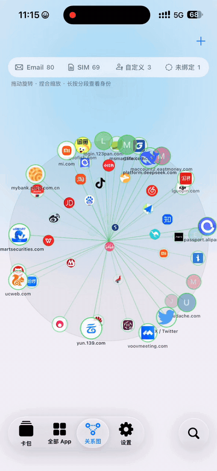
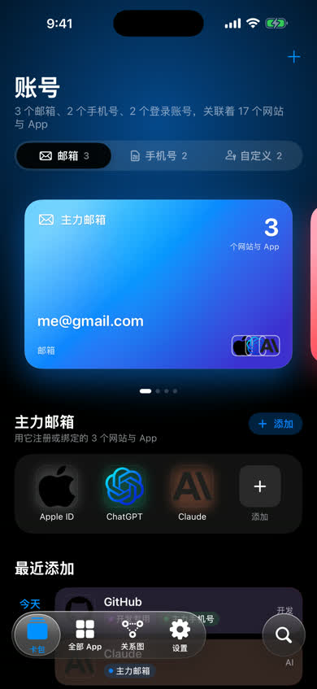
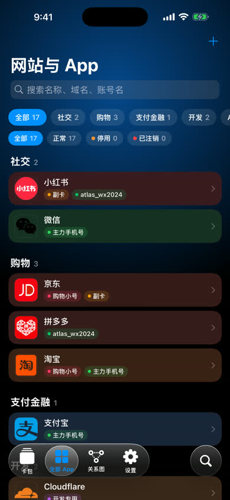
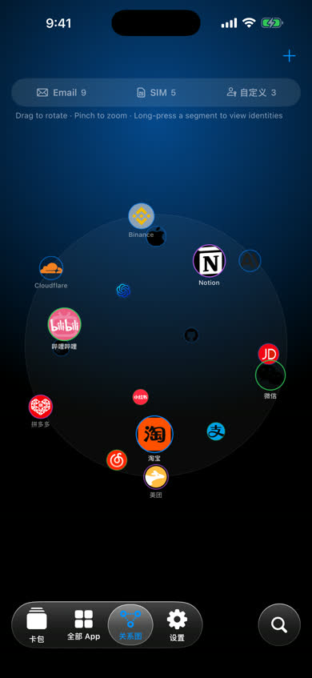
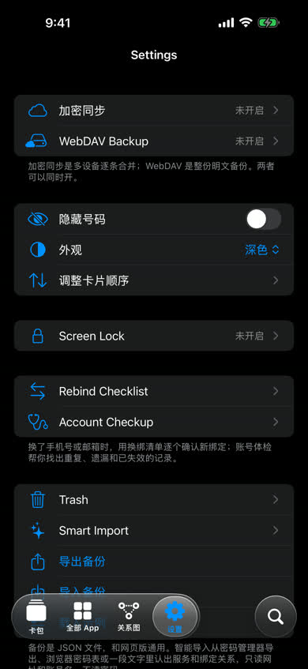

# 绑哪儿 · BangNaEr

**你的账号都绑在哪儿，一眼看清。**

绑哪儿是一款 iOS 账号绑定记录应用：把邮箱、手机号、QQ、微信、Apple、Google 等「登录身份」，和它们各自绑定的网站 / App 记在一起。哪个服务绑的是哪个邮箱、哪个手机号，换绑、注销、体检时不用再靠记忆翻聊天记录。

数据只存在你自己的设备上，可通过你自己的 WebDAV（如自建 OpenList）备份恢复，不经过任何第三方服务器。

## 截图

| 卡包 | 全部 App |
| --- | --- |
|  |  |

| 关系图 | 设置 |
| --- | --- |
|  |  |

## 功能

- **身份卡包**：邮箱 / 手机号 / QQ / 微信 / Apple / Google / 自定义登录卡，滑动翻卡，一张卡看清它绑定的全部服务
- **三维关系球**：所有服务排成一颗球，拖动 360° 旋转、捏合缩放；长按顶部分组弹出该组身份列表，选中一个身份后球上只显示它绑定的服务，点空白恢复
- **智能导入**：从密码管理器导出文件（Vaultwarden / Bitwarden）、浏览器 CSV、纯文本或剪贴板自动识别出邮箱 / 手机号与服务并预览去重——导入过程从不读取密码字段
- **自动识别添加**：添加身份时自动给出剪贴板里的邮箱 / 手机号候选，点一下填入
- **WebDAV 备份**：保存后自动备份到你自己的 WebDAV（带内容比对，不重复上传），换机一键恢复；也支持 Gist 同步与 JSON 导入导出
- **回收站**：删错不慌，删除先进回收站，可恢复
- **PIN 锁**：4–6 位 PIN（可选 Face ID），冷启动与后台超时自动上锁
- **换绑清单与账号体检**：换手机号 / 邮箱时生成逐项打勾的换绑清单；体检找出未绑任何身份的服务、重复绑定等问题
- **登录方式与状态标记**：每个服务可标登录方式（密码 / 短信 / 第三方登录等）与状态，详情页可前往登录或复制账号
- **服务图标**：优先取自 [离歌图标包](https://github.com/Catsouth/lige_icon)（1,000+ 国内服务图标），缺失时自动补抓官方图标

## 构建

本仓库不含 Xcode 工程：GitHub Actions 在 macOS 上用 `swiftc` 直接编译 `native-app/native/*.swift` 并打包未签名 IPA（构建号 = 提交数 + 1000），用你自己的证书签名后安装。模拟器截图由同一工作流的 preview 任务产出。

网页版（v1.10.2）已冻结，仍可访问：<https://bind.465871.xyz>

## 开源与致谢

本项目基于 [Ckxkx/account-atlas](https://github.com/Ckxkx/account-atlas) v2.2 的原生 SwiftUI 源码改造，整体以 **GPL-3.0** 开源（见 [LICENSE](LICENSE) 与 [NOTICE.md](NOTICE.md)）。原项目的品牌资产（Logo、图标）不在 GPL 授权范围内，本项目未使用，App 图标为自制。
